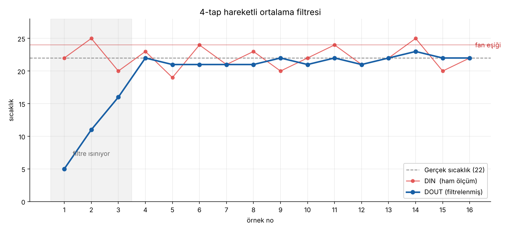
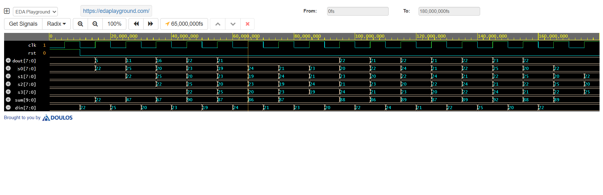

# Moving Average Filter — VHDL

A 4-tap moving average filter: it takes a noisy signal and smooths it.
Small project, but it covers the basics of how a DSP block is built in
hardware.

## The problem

Every real measurement carries noise. A temperature sensor reading a room
that is really at 22 °C gives you something like:

```
22, 25, 20, 23, 19, 24, 21, 23, 20, 22, ...
```

The room is not changing — this is electrical noise, ADC quantisation
error, interference picked up by the wires. If you build a rule like
"turn on the fan above 24 °C", the fan switches on and off at random.

The noise here is ±3 °C, which is larger than the 2 °C change you
actually care about. A single reading simply does not contain enough
information to tell a real change from noise.

## The idea

The signal is slow, the noise is fast and random. Averaging separates the
two: real values add up consistently, random errors cancel each other out.
Average N samples and the noise drops by √N.

This is why the circuit is also called a **low-pass filter** — it lets slow
changes through and blocks fast ones.

## Result



Raw readings (red) cross the fan threshold four times even though the room
never warms up. The filtered output (blue) stays near the true value of
22 and never crosses it.

The grey area is the filter warming up: after reset the registers hold
zeros, so the first N outputs are not valid yet.

## How it works

Four registers hold the last four samples. Every clock edge the chain
shifts one step: the new sample enters, the oldest one falls off.

```
DIN ──> [s0] ──> [s1] ──> [s2] ──> [s3] ──> dropped
        newest                     oldest
          │        │        │        │
          └────────┴───┬────┴────────┘
                       ▼
                   sum, then / 4
                       ▼
                     DOUT
```

```vhdl
s0 <= DIN;
s1 <= s0;
s2 <= s1;
s3 <= s2;
```

All four assignments happen on the same edge. Because signal assignments
take effect at the end of the edge, each register gets the *old* value of
its neighbour, so the chain shifts correctly without any extra logic.

Dividing by 4 is a 2-bit arithmetic right shift, which costs nothing in
hardware. This is why the window size is always a power of two — dividing
by 10 would need a real divider circuit.

## Bit widths

My first thought was that the output fits in 8 bits, and that part is
correct. An average can never leave the range of its inputs:

```
 4 × 127  / 4 =  127   (largest possible)
 4 × -128 / 4 = -128   (smallest possible)
```

Both fit in `signed(7 downto 0)`, so 8 bits in, 8 bits out.

What I missed is that the *sum* on the way there does not fit:

```
127 + 127 + 127 + 127 = 508
```

8-bit signed only reaches 127. And VHDL does not widen automatically —
adding two `signed(7 downto 0)` values gives another `signed(7 downto 0)`,
so the result wraps around silently.

The general rule: summing N values of W bits needs **W + log₂(N)** bits.
Here 8 + 2 = 10. So the values are widened before adding, and narrowed
again after the shift:

```vhdl
sum  <= resize(s0, 10) + resize(s1, 10) + resize(s2, 10) + resize(s3, 10);
DOUT <= resize(shift_right(sum, 2), 8);
```

Compute wide, output narrow.

## Choosing the window size

Two formulas decide N:

```
noise reduction = √N
filter delay    = N × Ts        (Ts = sampling period)
```

So you pick the largest N whose delay you can still tolerate, then round
down to a power of two:

```
N ≤ acceptable delay / Ts
```

Example — a room temperature sensor, 1 second of delay is fine, the ADC
samples every 1 ms:

```
N ≤ 1000 ms / 1 ms = 1000
nearest power of two below that = 512
noise reduction = √512 ≈ 22×
```

Note that a *faster* ADC makes the filter better, not worse: more samples
per second means more averaging for the same delay. Oversampling on
purpose and averaging is a standard way to gain resolution.

**This project uses N = 4** only because it is small enough to check by
hand — you can add four numbers and verify every output in the waveform.
Going to 8 or 16 is a one-line change.

For a large N you would not build it this way, though: 512 registers is
4096 flip-flops, and summing 512 values at once needs a huge adder tree.
Real designs keep a running sum instead:

```
sum = sum + newest - oldest
```

Two operations regardless of N.

## Simulation



The testbench feeds the 16 noisy readings, one per clock edge. In the
waveform you can watch a value travel from `s0` down to `s3`.

Console output:

```
DIN = 22   DOUT = 5     <- filter still filling up
DIN = 25   DOUT = 11
DIN = 20   DOUT = 16
DIN = 23   DOUT = 22    <- filter full from here on
DIN = 19   DOUT = 21
DIN = 24   DOUT = 21
...
DIN = 20   DOUT = 22
DIN = 22   DOUT = 22
```

Input swings between 19 and 25 (±3), output stays between 21 and 23 (±1).
Noise roughly halved, as √4 = 2 predicts.

A waveform is the right tool for control signals, but not for data. To
actually see what a filter does you plot the numbers — that is what
`Graph.png` is.

## Files

| File | Description |
|---|---|
| `moving-average-filter.vhd` | The filter |
| `moving-average-filter_tbh.vhd` | Testbench with 16 noisy samples |
| `Graph.png` | Input vs output |
| `Wave.png` | Simulation waveform |

## Run it

**EDA Playground:** paste both files, select VHDL with GHDL, set the top
entity to `moving_avg_tb`, enable *Open EPWave after run*.

**GHDL:**

```bash
ghdl -a moving-average-filter.vhd moving-average-filter_tbh.vhd
ghdl -e moving_avg_tb
ghdl -r moving_avg_tb --vcd=wave.vcd
```

## Tools

- VHDL
- [EDA Playground](https://www.edaplayground.com/) with GHDL and EPWave